 
 

 

I take software apart to see how it works, then build things that last.
 
Reverse engineering, full-stack products, and the automation in between.

 

<table align="center" width="100%">
<tr>
<td width="33%" valign="top" align="center">

### Reverse Engineering

Understanding how closed systems really work.

</td>
<td width="33%" valign="top" align="center">

### Full-Stack

Web apps built end to end, from interface to database.

</td>
<td width="33%" valign="top" align="center">

### Automation

Services, bots and pipelines that run on their own.

</td>
</tr>
</table>

 

### Toolbox

<table align="center">
<tr>
<td align="right" width="150"><b>Languages</b></td>
<td>

</td>
</tr>
<tr>
<td align="right"><b>Web&nbsp;&amp;&nbsp;Apps</b></td>
<td>

</td>
</tr>
<tr>
<td align="right"><b>Data&nbsp;&amp;&nbsp;Infra</b></td>
<td>

</td>
</tr>
<tr>
<td align="right"><b>Reverse&nbsp;Eng.</b></td>
<td>

</td>
</tr>
<tr>
<td align="right"><b>Tooling</b></td>
<td>

</td>
</tr>
</table>

 

### Activity

 

  

 

